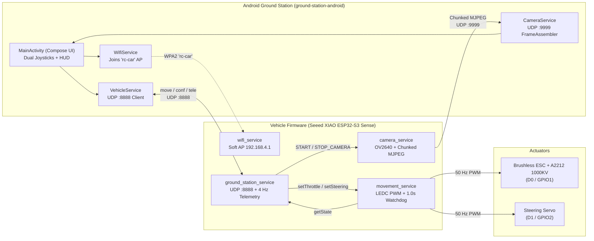

# RC Car Project (Seeed XIAO ESP32-S3 Sense + A2212 1000KV)

A 3D-printed, Wi-Fi controlled FPV remote-controlled (RC) car built around a **Seeed Studio XIAO ESP32-S3 Sense** microcontroller with an onboard camera, propelled by an **A2212 1000KV** brushless drone motor and ESC, and piloted from a custom **Android Ground Station** app.

---

## Hardware & Electronics

### Core Components
| Subsystem | Component | Details |
| --- | --- | --- |
| **Microcontroller & Vision** | **Seeed Studio XIAO ESP32-S3 Sense** | Dual-core ESP32-S3 @ 240 MHz, 8 MB Flash, 8 MB OPI PSRAM, OV2640/OV5640 camera sensor, external Wi-Fi antenna |
| **Drive Motor** | **A2212 1000KV** Brushless Outrunner | Drone brushless motor driving the rear drivetrain via a 3D-printed spur gear and dogbone shafts |
| **Motor Controller** | **Brushless ESC** | Standard 50 Hz servo PWM (`1000–2000 µs`), armed by holding `1000 µs` for 2.0 s at boot |
| **Steering** | **Hobby Servo** | Standard 50 Hz PWM (`800–2200 µs` extended travel, `1500 µs` + `20 µs` center trim, inverted direction) |
| **Interface Board** | **Custom Perfboard (`vehicle/board.diy`)** | `48.26 × 63.5 mm` perfboard providing GPIO RC low-pass protection filters and power rail decoupling |

### Pin & PWM Allocation (XIAO ESP32-S3 Sense)
Because the onboard camera occupies GPIOs `10–18` and `38–48` as well as `LEDC_TIMER_0` / `LEDC_CHANNEL_0` (20 MHz `XCLK`), the actuators use the free header pins and `LEDC_TIMER_1`:

| Signal | XIAO Pin | ESP32-S3 GPIO | LEDC Channel | LEDC Timer | Pulse Range | Mapping |
| --- | --- | --- | --- | --- | --- | --- |
| **ESC (Throttle)** | `D0` | `GPIO1` | Channel `2` | Timer `1` (50 Hz, 14-bit) | `1000–2000 µs` | `1000 + 10 * throttle` (`0..100`) |
| **Steering Servo** | `D1` | `GPIO2` | Channel `3` | Timer `1` (50 Hz, 14-bit) | `800–2200 µs` | `1500 + trim - 6.25 * steering` (`-100..100`) |

### Electronics Board (`vehicle/board.diy`)
The circuit layout (editable with [DIY Layout Creator](https://github.com/bancika/diy-layout-creator)) implements two protective stages on a `48.26 × 63.5 mm` perfboard:
1. **PWM Signal Filtering & Protection**: Three channels between 3-pin headers `PH8` and `PH7`, each with a **1 kΩ series resistor** (`R1`, `R4`, `R5`) and a **4.7 nF ceramic capacitor to ground** (`C8`, `C9`, `C10`, cutoff $f_c \approx 34\text{ kHz}$). This protects the 3.3 V ESP32-S3 GPIOs and suppresses high-frequency switching noise from the brushless ESC/motor while passing the 50 Hz PWM pulses cleanly.
2. **Power Distribution & Bulk Decoupling**: Two capacitor banks, each combining a **470 µF (63 V) electrolytic capacitor** (`C11`, `C13`) in parallel with a **100 nF ceramic capacitor** (`C12`, `C14`) across the power headers (`PH12`–`PH16`, `PH9`, `PH11`) to absorb transient current draws from the steering servo and stabilize the 5 V BEC supply.

---

## Repository Structure

```text
.
├── AGENTS.md                        # Root guidance for AI coding agents
├── README.md                        # Project documentation
├── vehicle/                         # Onboard firmware, electronics, and 3D CAD
│   ├── AGENTS.md                    # Detailed vehicle firmware & protocol reference
│   ├── board.diy                    # DIYLC electronics board layout
│   ├── cad/                         # FreeCAD source models (.FCStd) & 3D print files (.3mf)
│   └── esp32s3/rc/                  # PlatformIO / Arduino C++ firmware for XIAO ESP32-S3 Sense
└── ground-station-android/          # Android controller & FPV viewer app (Kotlin / Jetpack Compose)
```

---

## Software Architecture



### 1. Vehicle Firmware (`vehicle/esp32s3/rc/`)
Each subsystem runs in its own FreeRTOS task initialized by `src/main.cpp`:
- **`configuration`**: Loads/saves settings (`movement`, `camera`, `ground_station`, `wifi`, `log_level`) in ESP32 NVS (`Preferences` namespace `"rc"`), falling back to compiled-in defaults when keys are absent.
- **`camera_service`**: Reserves two `FRAMESIZE_UXGA` framebuffers in OPI PSRAM at boot before Wi-Fi starts, scales down to the requested resolution on demand, flips the sensor vertically (`vflip = true` for inverted mounting), and streams chunked MJPEG frames from a dedicated task (`priority = 3`) over a raw lwIP UDP socket.
- **`wifi_service`**: Starts the `rc-car` WPA2 Soft AP (`192.168.4.1/24`, channel 1, Wi-Fi sleep disabled for low latency).
- **`movement_service`**: Configures 14-bit 50 Hz LEDC PWM outputs, holds `1000 µs` for `2.0 s` on boot to arm the ESC, and runs the **command-timeout failsafe watchdog** (`priority = 5`). If no drive command arrives within `1.0 s`, throttle is cut to `0` (`1000 µs`) until a fresh command arrives.
- **`ground_station_service`**: Polls UDP `:8888` (`priority = 6`) for `move` and `conf` datagrams, drops stale/reordered sequence numbers, and transmits `tele` packets back to the operator at 4 Hz (`priority = 4`).

### 2. Android Ground Station (`ground-station-android/`)
A landscape-only full-screen Jetpack Compose app:
- **Dual Touch Joysticks**: Left side controls forward throttle (`0..100%`), right side controls steering (`-100..100%`), automatically returning to `0` on release.
- **One-Tap Wi-Fi Binding**: Uses Android's `WifiNetworkSpecifier` (`WifiService.kt`) to connect directly to `rc-car` and binds the app process to that network even though it has no internet access.
- **FPV Video & Presets**: Reassembles incoming UDP MJPEG chunks on port `9999` and renders them onto a `SurfaceView` while reporting live bitrate in `Mbps`. Includes signal presets tuned for the XIAO ESP32-S3 Sense (`Very strong` 1280×720@15fps, `Strong` 800×600@25fps, `Average` 640×480@20fps, `Weak` 480×320@15fps).

---

## Wire Protocols

### Control & Telemetry (`UDP :8888`, UTF-8 text)
Messages follow `<type>:<seq>,<field>,<field>` where `seq` is a monotonic counter used to discard out-of-order packets:

| Message | Direction | Description |
| --- | --- | --- |
| `move:<seq>,<throttle>,<steering>` | Ground → Vehicle | Drive command sent every 40 ms (~25 Hz). `throttle` $\in [0, 100]$, `steering` $\in [-100, 100]$. |
| `conf:<seq>,GROUND_HELLO,null` | Ground → Vehicle | Resets the vehicle's last-seen `seq` counter upon socket (re)connection. |
| `conf:<seq>,START_CAMERA,<w>,<h>,<fps>` | Ground → Vehicle | Starts/reconfigures MJPEG streaming to the sender's IP on UDP `:9999`. |
| `conf:<seq>,STOP_CAMERA,null` | Ground → Vehicle | Stops the MJPEG video stream. |
| `tele:<seq>,<throttle>,<steering>` | Vehicle → Ground | Periodic (4 Hz) actuator state feedback. |

### Video Stream (`UDP :9999`, Chunked MJPEG)
Each JPEG frame is split into `1400`-byte chunks prefixed by a 16-byte big-endian header so every datagram fits within the 1500-byte Wi-Fi MTU without IP fragmentation:

| Byte Offset | Size | Type | Description |
| --- | --- | --- | --- |
| `0..1` | 2 B | `char[2]` | Magic bytes `'J'`, `'F'` |
| `2` | 1 B | `uint8` | Protocol version (`1`) |
| `3` | 1 B | `uint8` | Flags (`0`) |
| `4..5` | 2 B | `uint16 BE` | Wrapping `frame_id` |
| `6..7` | 2 B | `uint16 BE` | `chunk_index` (`0 .. chunk_count - 1`) |
| `8..9` | 2 B | `uint16 BE` | `chunk_count` for this frame |
| `10..11` | 2 B | `uint16 BE` | Reserved (`0`) |
| `12..15` | 4 B | `uint32 BE` | Total JPEG size in bytes |
| `16..` | $\le 1400$ B | `uint8[]` | JPEG bytes starting at `chunk_index * 1400` |

---

## Building & Running

### Vehicle Firmware
Requires [PlatformIO](https://platformio.org/):

```bash
cd vehicle/esp32s3/rc
pio run                 # Compile firmware
pio run -t upload       # Flash to Seeed XIAO ESP32-S3 Sense over USB-C
pio device monitor      # Open 115200 baud serial monitor
```

### Android Ground Station
Open `ground-station-android/` in Android Studio or build from the command line:

```bash
cd ground-station-android
./gradlew assembleDebug
```
